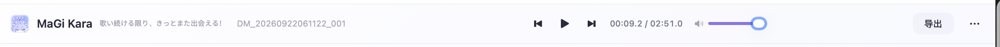
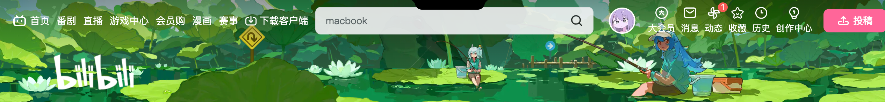
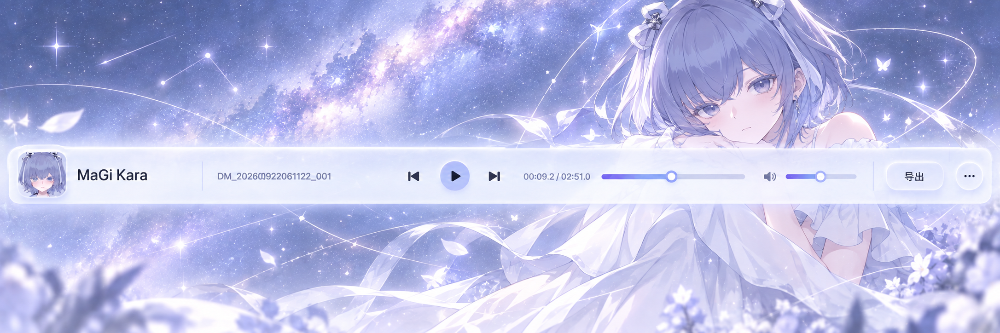

# MaGi Kara 顶部播放器 / 银河角色横条 RD

## 1. 背景与目标

重设计当前应用顶部的播放器/项目导航横条。保留现有功能结构，但将视觉从普通播放器控制栏升级为 Apple 风格的克制型产品界面：干净、轻盈、有空间感，同时融入淮水蕾的角色识别和紫蓝色宇宙氛围。

最终效果应是一个可以直接替换现有顶部区域的横向组件，而不是一张独立海报。

## 2. 参考素材

- 当前顶部播放器截图：
  `rd-assets/current-header.png`
- B 站横向视觉参考，仅参考其横向信息组织，不复制其高饱和风格：
  `rd-assets/bilibili-reference.png`
- 淮水蕾人设图：
  `rd-assets/huai-shuilei-character.png`
- 视觉概念参考：
  `rd-assets/cosmic-character-header.png`

### 2.1 可直接查看的视觉附件

以下图片是本 RD 的视觉依据，打开 RD 时应优先查看：

后续 RD 默认保留以下附件结构：原始界面截图、风格参考图、角色/品牌素材、最终概念稿或设计稿，并在正文中用图片直接展示，避免只提供文件路径。

## 3. 核心视觉方向

### 3.1 氛围

- Apple 式高级、克制、留白充足。
- 主色为暖白、冰蓝、淡薰衣草紫、柔和靛蓝。
- 禁止 B 站式高饱和粉绿、强烈大面积插画、游戏 HUD 感。
- 横条本身是产品界面，不要做成宣传 Banner。

### 3.2 背景层

将原本的地图层完全替换为宇宙主题：

- 淡紫蓝银河雾带。
- 少量清晰但不嘈杂的星点。
- 少量星座连线、轨道弧线或细微星尘。
- 可有一条很淡的银河带从横条横向穿过。
- 背景透明度不能过低，要看得出宇宙氛围，但不能压过播放器。
- 不要地图、海岸线、指南针、地点标记、地理标签。
- 不要巨型星球、宇航员、科幻 HUD、霓虹赛博朋克效果。

建议背景图层视觉不透明度约为 45%–70%，具体根据底色和可读性调整。

### 3.3 淮水蕾融合方式

淮水蕾不能只出现在左侧头像中，需要成为横条的主视觉层之一：

- 放在横条右侧约 30%–40% 区域。
- 使用半身或上半身裁切，适配长条形构图。
- 保留短款紫蓝色头发、双蝴蝶结、淡紫色眼睛和白色裙装特征。
- 人物自然裁切在横条上下边缘，不要硬贴 PNG 的矩形边界。
- 人物位于 UI 玻璃层之后，控件位于人物之前。
- 人物透明度不宜过低，需能辨认发型、脸部和白色服装；建议视觉不透明度约为 55%–75%。
- 人物周围可加入轻微银河雾、星尘和轨道线，使人物像从宇宙背景中自然出现。
- 不要放全身站立图，不要把人物压缩成很小的装饰，不要让人物遮挡播放控件。

## 4. 信息架构与布局

保持现有功能，不改变播放逻辑。

### 左侧：身份区

- 小型圆角头像，继续使用淮水蕾头像。
- 主标题：`MaGi Kara`
- 次标题：`歌い続ける限り、きっとまた出会える！`
- 可显示当前项目/音频名：`DM_20260922061122_001`
- 标题和次标题应优先于背景人物，保证可读。

### 中央：播放区

- 上一首。
- 播放 / 暂停主按钮。
- 下一首。
- 当前时间 / 总时长。
- 播放进度条。
- 音量图标与音量滑块。

### 右侧：操作区

- `导出` 按钮。
- 三点更多菜单。
- 操作区保持安静，不使用大面积高饱和按钮。

## 5. UI 样式规范

### 5.1 玻璃层

- 白色半透明圆角面板。
- 推荐背景：`rgba(255, 255, 255, 0.72–0.84)`。
- 使用适度背景模糊，不要过度磨砂导致星空和人物完全消失。
- 轻微白色描边和柔和阴影。
- 圆角建议 18–24px，具体跟随现有设计系统。

### 5.2 控件

- 图标使用细线、圆角、单色深靛蓝或灰紫色。
- 播放按钮可以比其他按钮稍突出，但不要使用高饱和色块。
- 进度条使用柔和紫蓝渐变，滑块为白色或浅蓝色。
- 分隔线极细、低对比度。

### 5.3 文字

- 主标题比当前普通文本更有品牌感，但不要过大。
- 次标题和音频名使用低对比度灰紫色。
- 禁止出现随机英文、乱码、假 Logo 或额外文案。
- 文字必须在浅色玻璃层上保持可读，必要时增加极轻的文字阴影。

## 6. 推荐尺寸与响应式

### 桌面端

- 横条宽度：`100%`。
- 高度建议：`112–136px`，以当前顶部区域高度为基准微调。
- 内容最大宽度可跟随主页面容器，但背景人物和银河层可以延伸到全宽。
- 使用 CSS Grid 或 Flex，将身份区、播放区、操作区稳定分栏。

### 窄屏

- 优先保留头像、MaGi Kara、播放/暂停、进度和导出。
- 隐藏次标题、音频名或音量滑块，避免挤压。
- 淮水蕾仍保留右侧轮廓，但降低可视面积，不遮挡交互控件。

## 7. 动效建议

第一版以静态视觉为主，不增加复杂动效。若项目已有动效系统，可选：

- 银河雾缓慢漂移。
- 星点极轻微闪烁。
- 进度条保留原本的交互动画。

动效必须低存在感，不能影响播放器操作和文字阅读。

## 8. 验收标准

- [ ] 这是一个可直接替换当前顶部区域的横向组件，而不是独立海报。
- [ ] 原播放器功能和信息结构全部保留。
- [ ] 背景中不再出现地图、海岸线、指南针或地点标记。
- [ ] 能明显感受到星空、银河和宇宙氛围。
- [ ] 淮水蕾以横条中的半身/上半身视觉层出现，不只是头像。
- [ ] 人物发型、双蝴蝶结、紫蓝色调和白色服装仍然可辨认。
- [ ] 角色在 UI 玻璃层之后，控件、文字和按钮在角色之上。
- [ ] 背景和人物有存在感，但不抢播放器内容。
- [ ] 整体比 B 站参考更克制、更干净、更像 Apple 产品。
- [ ] 桌面端布局不拥挤，窄屏端有合理降级。
- [ ] 没有随机文字、乱码、假 Logo、水印或多余装饰。

## 9. 本次实现边界

本次只重做顶部播放器/导航视觉层和布局，不修改：

- 音频播放逻辑。
- 播放进度和音量逻辑。
- 导出功能。
- 更多菜单功能。
- 其他页面的整体视觉系统。
